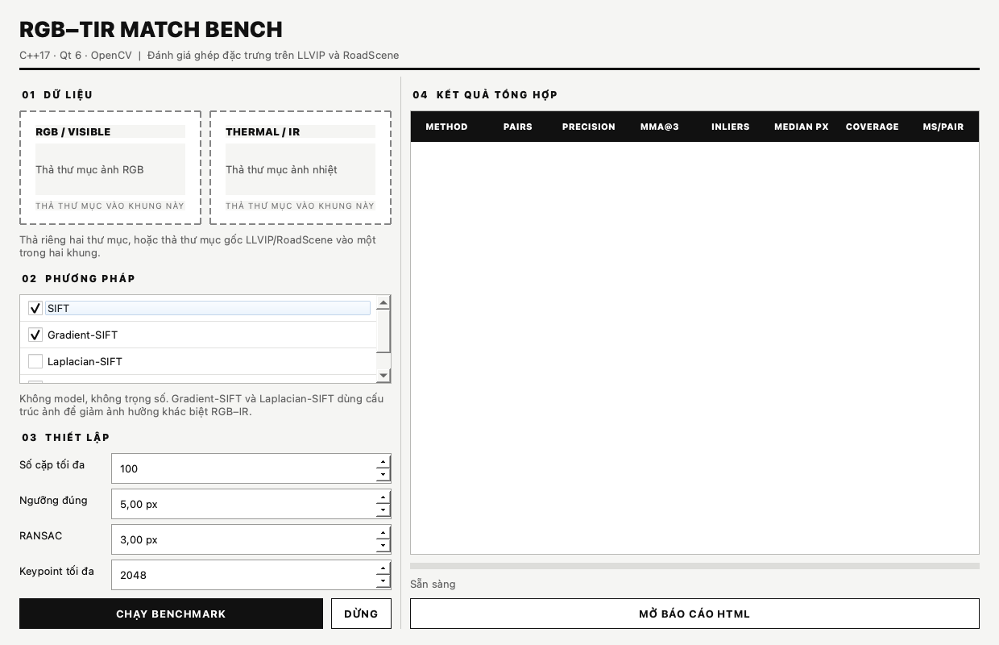

# RGB–TIR Match Bench — C++/Qt

Ứng dụng desktop **C++17 + Qt 6 Widgets + OpenCV** để đánh giá ghép đặc trưng giữa ảnh RGB và ảnh nhiệt trên LLVIP và RoadScene. Không dùng Python hoặc PySide ở runtime.

> L. Morelli et al., “Evaluating Deep Learning Local Features for RGB-Thermal Image Matching and 3D InfraRed Thermography,” *Geomatics*, 6(4), 83, 2026. [DOI 10.3390/geomatics6040083](https://doi.org/10.3390/geomatics6040083).



## Điểm chính

- Giao diện Qt Widgets viết hoàn toàn bằng C++.
- Hai vùng kéo‑thả vuông cho thư mục RGB và IR; không có hộp chọn tệp chen vào quy trình.
- Tự nhận dạng cấu trúc LLVIP và RoadScene.
- Toàn bộ nút bấm và giao diện dùng bảng màu đơn sắc trắng–đen–xám.
- Benchmark chạy trong `QThread`, không làm treo giao diện; hỗ trợ dừng sau cặp hiện tại.
- Matcher tích hợp sẵn trong binary: SIFT, Gradient-SIFT, Laplacian-SIFT và ORB.
- Xuất `per_pair.csv`, `summary.csv`, `results.json` và `report.html`.
- Unit test bằng Qt Test và CI GitHub Actions.

Không có model, checkpoint, ONNX hay trọng số phải nạp thêm. SIFT là baseline thủ công chính được bài báo dùng để chỉ ra khó khăn của ghép RGB–TIR. Gradient-SIFT và Laplacian-SIFT chuyển hai modality sang biểu diễn cấu trúc trước khi trích đặc trưng, nhờ đó tạo đối chứng không cần học máy; ORB là baseline nhị phân nhẹ.

## Phạm vi khoa học

Bài báo đánh giá hai tầng:

1. chất lượng correspondence giữa ảnh RGB–TIR;
2. bundle adjustment và RMSE 3D trên check point trắc địa milimet.

LLVIP và RoadScene là dữ liệu cặp ảnh đã căn chỉnh nhưng không có đầy đủ pose camera, multi-view track và check point 3D tương đương Thermitage. Do đó chương trình này kiểm chứng **matching accuracy 2D**, không biến metric 2D thành RMSE 3D của bài báo.

## Metric

Với ảnh đã căn chỉnh, tọa độ điểm nhiệt được chuẩn hóa về kích thước ảnh RGB:

```text
eᵢ = ||xᵢ_RGB − scale(xᵢ_IR)||₂
```

- `Precision@τ`: tỷ lệ match có `eᵢ ≤ τ`, mặc định `τ = 5 px`.
- `MMA@1/3/5/10`: Mean Matching Accuracy tại bốn ngưỡng pixel.
- Mean, median và P95 reprojection error.
- Homography RANSAC inlier ratio và inlier RMSE.
- `Coverage 4×4`: tỷ lệ ô ảnh có ít nhất một match.
- Thời gian xử lý trung bình theo cặp.

## Yêu cầu

- Trình biên dịch hỗ trợ C++17: Apple Clang, GCC hoặc MSVC.
- CMake 3.22 trở lên.
- Qt 6.4 trở lên, module Widgets và Test.
- OpenCV 4 trở lên với `features2d` và `calib3d`.
- Ninja được khuyến nghị nhưng không bắt buộc.

## Build trên macOS

```bash
brew install cmake ninja qt opencv
git clone https://github.com/soncris3012/rgbtir-match-bench-qt.git
cd rgbtir-match-bench-qt

cmake --preset release \
  -DCMAKE_PREFIX_PATH="$(brew --prefix qt)" \
  -DOpenCV_DIR="$(brew --prefix opencv)/lib/cmake/opencv5"
cmake --build --preset release
ctest --preset release

open build/release/rgbtir-match-bench.app
```

Nếu Homebrew cung cấp OpenCV 4, thay `opencv5` bằng `opencv4`.

## Build trên Ubuntu/Debian

```bash
sudo apt update
sudo apt install build-essential cmake ninja-build qt6-base-dev libopencv-dev

cmake -S . -B build -G Ninja -DCMAKE_BUILD_TYPE=Release
cmake --build build --parallel
ctest --test-dir build --output-on-failure
./build/rgbtir-match-bench
```

## Build trên Windows

Cài Qt 6, OpenCV và Visual Studio 2022, sau đó:

```powershell
cmake -S . -B build -G "Visual Studio 17 2022" `
  -DCMAKE_PREFIX_PATH="C:/Qt/6.8.0/msvc2022_64" `
  -DOpenCV_DIR="C:/opencv/build"
cmake --build build --config Release
ctest --test-dir build -C Release --output-on-failure
```

Chạy `windeployqt` để đóng gói DLL Qt trước khi chuyển ứng dụng sang máy khác.

## Dữ liệu

Tải dữ liệu từ nguồn chính thức và tuân thủ giấy phép riêng:

- [LLVIP](https://github.com/bupt-ai-cz/LLVIP)
- [RoadScene](https://github.com/hanna-xu/RoadScene)

LLVIP:

```text
LLVIP/
├── visible/
│   ├── train/*.jpg
│   └── test/*.jpg
└── infrared/
    ├── train/*.jpg
    └── test/*.jpg
```

RoadScene:

```text
RoadScene/
├── crop_LR_visible/*.jpg
└── cropinfrared/*.jpg
```

## Sử dụng

1. Kéo thư mục `visible` vào ô bên trái và `infrared` vào ô bên phải. Cũng có thể kéo cả thư mục gốc LLVIP/RoadScene vào một trong hai ô để ứng dụng tự nhận dạng.
2. Chọn một hoặc nhiều matcher.
3. Đặt số cặp tối đa, ngưỡng đúng, ngưỡng RANSAC và số keypoint.
4. Bấm **CHẠY BENCHMARK**.
5. Xem bảng kết quả hoặc bấm **MỞ BÁO CÁO HTML**.

Mỗi lần chạy được lưu tại:

```text
runs/YYYYMMDD-HHMMSS/
├── per_pair.csv
├── summary.csv
├── results.json
└── report.html
```

Chương trình lấy cùng một tập cặp ảnh cho mọi matcher với seed cố định `42`, tránh so sánh trên các mẫu khác nhau.

## Cấu trúc mã nguồn

```text
src/
├── main.cpp
├── core/
│   ├── BenchmarkEngine.*
│   ├── BenchmarkTypes.h
│   ├── DatasetPairer.*
│   ├── FeatureMatcher.*
│   ├── MetricCalculator.*
│   └── ReportWriter.*
├── ui/
│   ├── DropZone.*
│   └── MainWindow.*
└── worker/
    └── BenchmarkWorker.*
```

## Thêm matcher C++ mới

1. Tạo lớp kế thừa `IFeatureMatcher`.
2. Trả về `MatchResult` gồm hai vector tọa độ tương ứng.
3. Đăng ký tên và factory trong `FeatureMatcherFactory`.
4. GUI, RANSAC, metric và report sẽ dùng matcher mới tự động.

Các phương pháp hiện tại đều chạy ngay sau khi build, không tải model từ Internet và không yêu cầu đường dẫn trọng số.

## Kiểm thử

```bash
cmake --preset release
cmake --build --preset release
ctest --preset release
```

Test kiểm tra nhận dạng LLVIP, ghép cặp theo tên, fallback theo thứ tự, identity accuracy và chuẩn hóa khi hai modality khác kích thước.

## Giấy phép

Mã nguồn dùng MIT License. Dữ liệu, OpenCV, Qt và pretrained model nếu được bổ sung có giấy phép riêng và không được bao gồm mặc định trong repository này.

